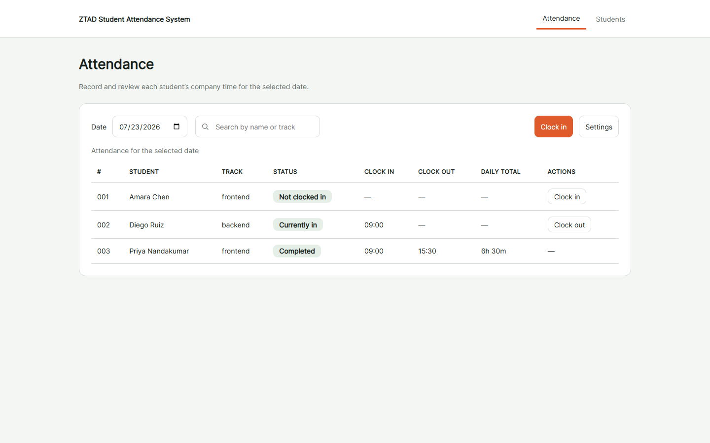
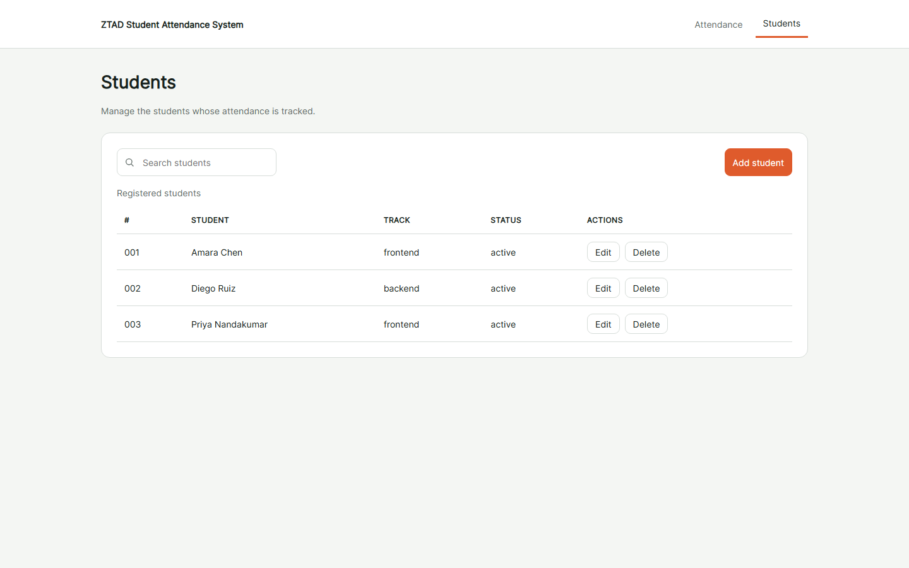
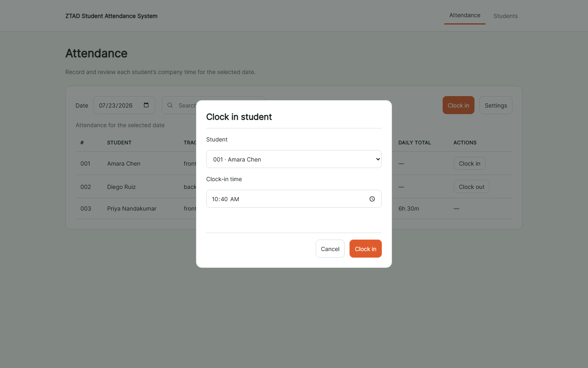
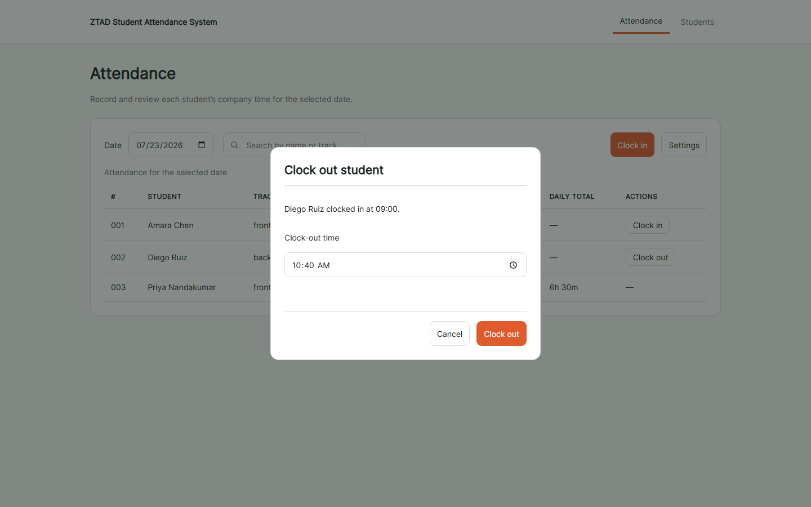
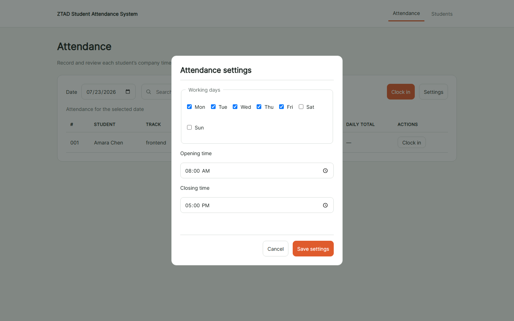

# ZTAD Student Attendance System

A beginner project in plain HTML, CSS and browser JavaScript. You will build a
complete, working attendance application **from scratch** — your own HTML, your own
CSS, and your own JavaScript — using only this guide. There are no frameworks, no
build tools and no package installs. Everything runs in the browser.

This README is the whole brief. It explains what to build, how the data is shaped,
and the rules the app must follow. It deliberately contains **no code** — working out
the code is the exercise. Read it start to finish before you begin.

## 1. Project goal

An instructor runs this application on one shared classroom computer to track student
attendance. With it, the instructor can:

- keep a list of students (add, edit, and delete them);
- record one clock-in and one clock-out for each student on each working day;
- see, at a glance, who has not clocked in, who is currently in, and who has finished
  for the day;
- change the working days and the opening and closing times.

There are two pages: an **Attendance** page and a **Students** page, linked by a shared
header. Data is saved in the browser so it survives a page reload.

## 2. What you will practise

- writing semantic HTML: headings, navigation, tables, forms, and dialogs;
- styling a clean, readable interface with your own CSS;
- modelling data with JavaScript arrays and objects;
- reading and writing browser `localStorage`, and turning objects into text and back;
- rendering stored data into table rows;
- handling form submissions, validation, and native dialog boxes;
- working with dates and times, including converting times into minutes;
- keeping the interface correct as the data changes.

## 3. Required VS Code Live Server setup

You must run this project through the **Live Server** extension for Visual Studio
Code. Do not double-click an HTML file, and do not open it from a `file://` address.
The browser treats separate `file://` pages as different origins and will not reliably
share saved data between your two pages — your data will seem to vanish.

1. Open the project folder in VS Code.
2. Install the **Live Server** extension if you do not already have it (open the
   Extensions view and search for "Live Server").
3. Right-click your `attendance.html` file and choose **Open with Live Server**.
4. Your browser opens at an address beginning with `http://127.0.0.1:5500/`. Use the
   header links to move between the Attendance and Students pages.

## 4. The finished app (design examples)

Build your HTML and CSS to match these screenshots of the finished application. They
show the layout, the columns, the toolbar, and the dialogs you need to recreate.

### Attendance page

### Students page

### Clock-in dialog

### Clock-out dialog

### Settings dialog

## 5. Data model in plain English

Store everything in **one object** and keep that object in `localStorage` under the
key `ztad.studentAttendanceSystem.v1`. The object holds:

- a **version** number (use 1), so you can recognise your own data;
- the **next student number** to hand out — a counter that only ever goes up, so
  numbers are never reused even after a student is deleted;
- a **settings** object with the working days, the opening time, and the closing time;
- a **list of students**, where each student has: a stable unique id, a permanent
  student number, a full name, a track (either `frontend` or `backend`), and a status
  (always `active` in this version);
- a **list of attendance records**, where each record has: a stable unique id, the id
  of the student it belongs to, the work date, the clock-in time, the clock-out time
  (empty until they clock out), the closing time that was scheduled when they clocked
  in, and whether the clock-out was set by hand or automatically.

Create the stable ids with the browser's built-in random id generator. Store dates as
text like `2026-07-23` (year-month-day) and same-day times as text like `08:15`
(hours and minutes on a 24-hour clock).

## 6. The weekday rule (read this carefully)

This app numbers the days of the week **starting from Monday**: Monday is 0, Tuesday
is 1, Wednesday is 2, Thursday is 3, Friday is 4, Saturday is 5, and Sunday is 6.

So the default working days, Monday to Friday, are the numbers 0, 1, 2, 3, and 4.

Be careful: the browser's built-in "day of the week" for a date counts **from
Sunday** (Sunday is 0, Monday is 1, and so on). That is not the same numbering this
app uses. Before you check whether a date is a working day, you must convert the
browser's Sunday-first number into this app's Monday-first number. The conversion is:
add 6 to the browser's number, then take the remainder after dividing by 7. For
example, the browser calls Monday 1; add 6 to get 7; the remainder of 7 divided by 7
is 0 — Monday, exactly as this app expects. Sunday (the browser's 0) becomes 6.

The Settings dialog must list its seven checkboxes **Monday first** to match.

## 7. The milestones

Build the app in this order. Each milestone builds on the one before it.

1. **Build the HTML.** Create both pages: the shared header and navigation, the
   attendance table and the students table (each with a caption and proper column
   headers), the labelled forms with native date and time inputs, and the native
   dialog boxes. Match the screenshots.
2. **Style with CSS.** Write your own styles to match the finished look: 14px base
   text, generous spacing, lightly rounded corners, a light page background with white
   panels, dark text, one warm accent colour for the main buttons, and clear table
   lines. Keep it calm — no gradients or animations.
3. **Model the data.** Create the empty starting object described in section 5, with
   the default settings.
4. **Read and write localStorage.** Save the object as text and load it back as an
   object, always under the one key. Handle the case where the saved text cannot be
   read, and never overwrite good data when something goes wrong.
5. **Render the tables.** Turn the stored students and attendance into table rows.
6. **Add, edit, and delete students.** Adding gives a student the next permanent
   number. Editing changes the name or track but keeps the number. Deleting removes
   the student **and all of that student's attendance records**, after a confirmation.
7. **Record clock-in and clock-out.** Allow one clock-in and one clock-out per student
   per working day, and stop a second clock-in for the same student on the same day.
8. **Calculate durations.** Convert the clock times into minutes, subtract to get the
   day's length, and show it as hours and minutes.
9. **Apply the day and status rules.** Decide, for the selected date and each student,
   which status to show (see section 8), using the Monday-first weekday rule.
10. **Reconcile at closing time.** When the app opens, close any record that was left
    open past its scheduled closing time (see section 8).
11. **Verify and submit.** Work through the checklist in section 11 and submit.

## 8. Required behaviour

**The status column is calculated, never stored.** For the selected date and a given
student, show exactly one of these:

- **Upcoming** — the date is a future working day.
- **Not scheduled** — the date is not one of the configured working days.
- **Not started** — it is today, before the opening time, and there is no record yet.
- **Not clocked in** — it is today, within working hours, and there is no record yet.
- **Absent** — it is a past working day (or today after closing) with no record.
- **Currently in** — there is a clock-in but no clock-out.
- **Completed** — there is both a clock-in and a clock-out.

There is no "late" status. The app simply shows the actual clock-in time.

**The attendance rules:**

- The default schedule is Monday to Friday, 08:00 to 17:00. The instructor can change
  the working days and the two times in Settings. The opening time must be earlier
  than the closing time, and at least one working day must stay selected.
- A student may have at most one attendance record per work date.
- A live clock-in is allowed only for today, on a working day, at or after the opening
  time and before the closing time.
- A clock-out must be later than the clock-in, and no later than the closing time that
  was scheduled when the student clocked in.
- A past date can be corrected. Future dates are read-only. Days that are not working
  days create no absences.

**Automatic closing-time reconciliation.** A browser app cannot run while the browser
is closed, so "automatic clock-out" happens when the app next opens. On startup, look
at every record that has no clock-out. If its work date is in the past, or its work
date is today and the scheduled closing time has already passed, close it: set its
clock-out to the scheduled closing time and mark it as closed automatically. Save once
after checking them all.

**Deleting a student is permanent.** There is no undo in this version. Confirm before
deleting, and remember it also removes that student's attendance records.

## 9. Time calculation walkthrough

To measure a day, turn each `HH:mm` time into the number of minutes since midnight,
then subtract. Multiply the hours by 60 and add the minutes:

- `08:15 = 495 minutes` (8 times 60, plus 15)
- `16:45 = 1005 minutes` (16 times 60, plus 45)
- `1005 - 495 = 510 minutes = 8h 30m`

Format the result as hours and remaining minutes — for example, 510 minutes is
`8h 30m`. A record with no clock-out yet has no length; show a dash for it.

## 10. Saving and loading with localStorage

The browser can remember your data between reloads using `localStorage`. It only
stores **text**, so you turn your state object into text before saving and back into
an object after loading:

- to **save**, convert the object to a text form and store it under the key
  `ztad.studentAttendanceSystem.v1`;
- to **load**, read that text back and convert it into an object.

The tools for the conversion are the browser's `JSON.stringify` (object to text) and
`JSON.parse` (text to object); look them up as you need them.

Two warnings you must respect:

- **Reading text back can fail.** If the stored text is empty, cut off, or not valid,
  the conversion throws an error. Handle that error and show a clear message instead of
  a broken page. Never let a broken value overwrite good data — offer the instructor a
  way to start fresh on purpose.
- **You must use Live Server.** Saving and loading only work reliably when both pages
  are served from the same `http://` address. If you open the files from a `file://`
  address, the browser may not share storage between the pages and your data will seem
  to disappear.

## 11. Manual verification checklist

Run through all of these by hand once your app is built:

- The header links move between the Attendance and Students pages, and each page has a
  single main heading.
- You can add a student, edit their name or track, and delete them; deleting asks for
  confirmation and also removes that student's attendance.
- A new student gets the next number, and numbers are never reused after a deletion.
- You can clock a student in and then out; a second clock-in for the same student on
  the same day is refused.
- A clock-out earlier than the clock-in is refused.
- The daily total matches your own hand calculation (see section 9).
- Past dates can be corrected; future dates are read-only.
- Changing the Settings working days and times updates the statuses; the Settings
  checkboxes are listed Monday first, and a Saturday shows "Not scheduled" under the
  default schedule.
- A record left open on a past day shows as automatically closed the next time the app
  opens.
- Your data survives a page reload.
- The pages work with the keyboard, and there is no sideways scrolling of the whole
  page on a narrow screen.
- The browser console shows no red errors during any of the above.

## 12. Submission requirements

Submit your two HTML pages, your CSS, and your JavaScript. Your app must:

- run through VS Code Live Server (never a `file://` address);
- match the finished layout in the screenshots in section 4;
- pass every item on the checklist in section 11;
- show no red errors in the browser console.
